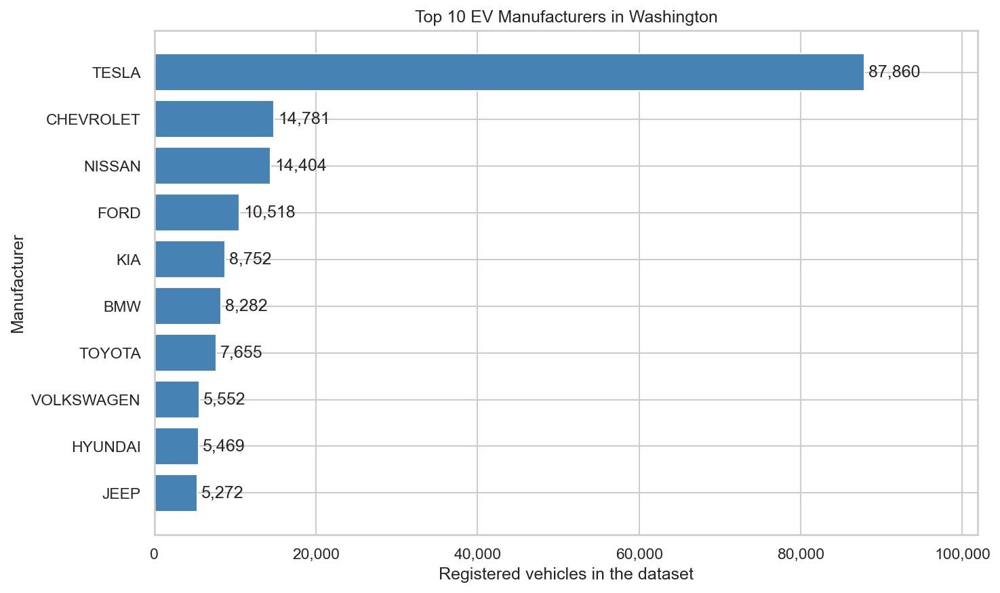
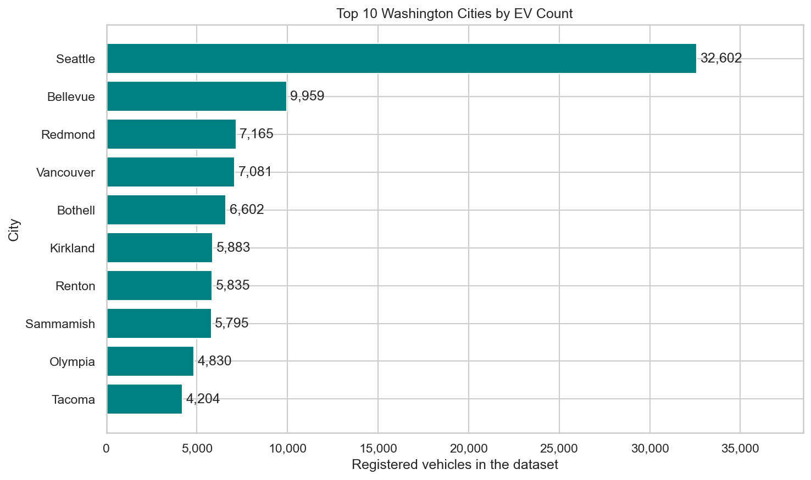
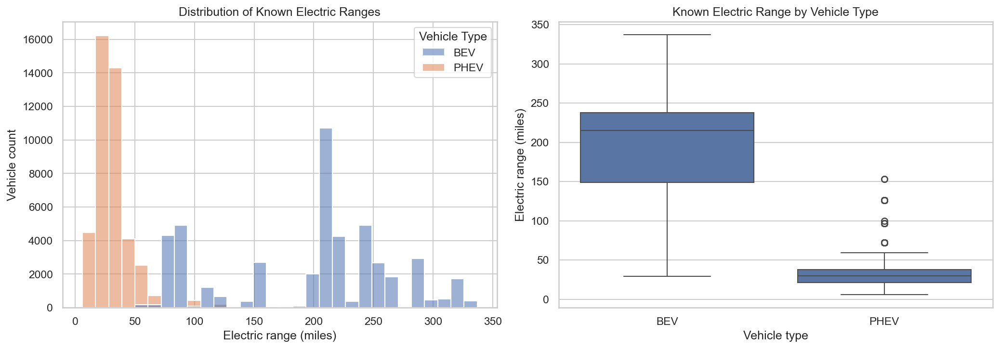

# Washington Electric Vehicle Population Analysis

An exploratory analysis of Washington's electric vehicle population,
examining manufacturer and model distribution, geographic patterns,
recorded electric ranges, and model-year composition.

The project emphasizes data quality: unknown ranges and unavailable
prices are identified before interpreting the results.

## Dataset

The analysis uses a fixed snapshot of Electric Vehicle Population Data
from the Washington State Department of Licensing.

- **Original dataset:** 200,048 records and 17 columns
- **Washington subset:** 199,606 records
- **Vehicle types:** Battery electric vehicles (BEVs) and plug-in
  hybrid electric vehicles (PHEVs)

The snapshot's exact extraction date has not been established.
These results describe the supplied dataset, not current population totals.

See [dataset documentation](data/README.md) for coverage, fields,
and cleaning decisions.

## Analysis

The notebook explores:

- Manufacturer and model popularity
- Cities with the most EV records
- Highest and lowest known electric ranges, including ties
- Range distributions by vehicle type, manufacturer, and model
- Model-year counts across leading manufacturers
- Known range distributions across major cities
- County variety of manufacturer-model pairs

## Key Findings

| Topic | Finding |
|---|---|
| Leading manufacturer | Tesla has the most EV records, followed by Chevrolet, Nissan, Ford, and Kia |
| Top five cities | Seattle, Bellevue, Redmond, Vancouver, and Bothell |
| Highest known range | 337 miles, shared by 84 Tesla Model S records |
| Lowest positive range | 6 miles, shared by 946 Toyota Prius Plug-in records |
| Median known BEV range | 215 miles |
| Median known PHEV range | 30 miles |
| Greatest county model variety | King County: 148 distinct manufacturer-model pairs |

Among the five leading manufacturers, model-year counts peak in 2023
for Tesla, Chevrolet, Ford, and Kia. Nissan's count peaks in 2013.
These are snapshot counts by model year, not annual sales or adoption rates.

### Manufacturer Distribution



### Geographic Distribution



### Known Electric Range



## Data Quality and Interpretation

- **54.70%** of Washington records have unresearched electric range.
  Zero ranges are excluded from known-range statistics.
- **98.34%** have unavailable MSRP. Pricing coverage is insufficient
  for broad conclusions about affordability or price versus range.
- BEVs and PHEVs are compared separately.
- Missing geographic values are retained without imputation.
- No duplicate rows or vehicle IDs were found in the Washington subset.
- City counts are absolute totals, not adoption rates adjusted for population.
- County model variety is not adjusted for vehicle count.
- Geographic comparisons are descriptive and do not establish causal effects.

The original CSV remains unchanged. Cleaning and derived fields are
created within the notebook.

## Project Files

| Path | Contents |
|---|---|
| `notebooks/washington_ev_population_eda.ipynb` | Analysis, charts, and interpretation |
| `data/raw/EV_Population_WA_Data.csv` | Original dataset snapshot |
| `data/README.md` | Dataset documentation |
| `reports/figures/` | Nine charts exported by the notebook |
| `requirements.txt` | Python dependencies |
| `.gitignore` | Files excluded from version control |

## Run the Analysis

Tested with **Python 3.12.2**, pandas **2.2.3**, matplotlib **3.10.8**,
and seaborn **0.13.2**.

From the project root, create a virtual environment:

```powershell
py -3.12 -m venv .venv
```

Install the dependencies:

```powershell
.\.venv\Scripts\python.exe -m pip install -r requirements.txt
```

In VS Code:

1. Open the project folder.
2. Open `notebooks/washington_ev_population_eda.ipynb`.
3. Select the `.venv` Python environment as the notebook kernel.
4. Run all cells.

Alternatively, launch Jupyter:

```powershell
.\.venv\Scripts\python.exe -m jupyter lab
```

The notebook supports execution from the project root or the
`notebooks` folder. Running it regenerates the charts in
`reports/figures/`.

## Tools

Python · pandas · Matplotlib · Seaborn · Jupyter

## Author

Muhammad Abdullah Zahid  
[GitHub](https://github.com/Lucid1498)